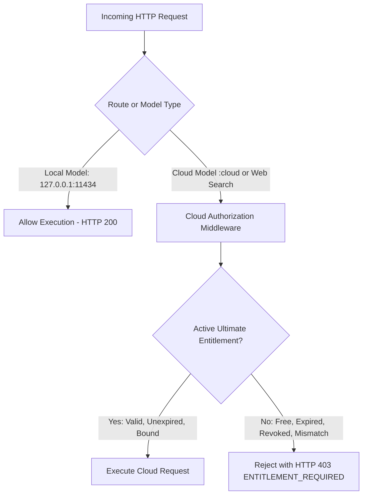

# IDeV Advanced Pro — Authentication & Licensing Architecture

**Target Version:** 3.8.9  
**Organization:** IDeV Limited  
**Security Boundary:** Server-Side Cryptographic Authorization & Gating  

---

## 1. Architecture Overview & Tier Model

IDeV Advanced Pro operates on a two-tier model designed to prioritize local workstation privacy while providing an entitlement-gated path to remote cloud intelligence:

| Dimension | **Free Tier** | **Ultimate Tier** |
|---|---|---|
| **Eligibility** | Default out-of-the-box tier for all profiles | Granted exclusively via valid 38-digit key activation |
| **Local Inference** | **Available** — Runs offline on `127.0.0.1:11434` without internet | **Available** — Full local engine access |
| **Local Chat History** | **Available** — Stored locally in `Storage/chats/` | **Available** — Fully preserved across updates |
| **Local Workspace Settings**| **Available** — Hardware governor, thread tuning, appearance | **Available** — Full workspace preferences |
| **Cloud Models (`:cloud`)** | **Locked** — Blocked at server middleware with HTTP 403 | **Available** — Pinned remote models (`☁️`) enabled |
| **Cloud Web Search** | **Locked** — Blocked for unentitled profiles | **Available** — Web intelligence & link fetching |
| **Entitlement Scope** | Offline local operations only | 60-day cloud execution bound to 1 device & 1 profile |
| **Network Outage Impact** | Zero impact — runs entirely local | Local models continue running uninterrupted |
| **Expiry Behavior** | Permanent local access | Gracefully reverts to Free tier; local data preserved |
| **Revocation Behavior** | Local functionality remains fully functional | Immediate termination of cloud execution permissions |

> [!NOTE]
> **Tier Simplicity**  
> IDeV Advanced Pro recognizes **only** `Free` and `Ultimate`. There are no intermediate or commercial tiers such as Pro, Premium, Enterprise, Gold, or VIP. Administrator roles represent operational permissions, not consumer subscription tiers.

---

## 2. 38-Digit Product Key Specifications

Ultimate tier cloud access is activated using a 38-digit product key.

### Key Anatomy & Encoding
Each product key is a high-precision 38-character decimal string:

```
[ 98 ] [ 26 Digits Cryptographic Entropy ] [ 10 Digits HMAC-SHA256 Checksum ]
  │                     │                                   │
Prefix            CSPRNG Entropy                    Timing-Safe Checksum
```

- **Prefix (`98`)**: 2-digit identifier designating the IDeV v2 licensing protocol.
- **Entropy (26 digits)**: Generated via `crypto.randomBytes(32)` converted into high-precision decimal representations.
- **HMAC Checksum (10 digits)**: SHA-256 HMAC digest computed across the prefix and entropy payload, truncated to 10 decimal digits.
- **High-Precision Storage**: JavaScript `Number` loses precision beyond 15–17 digits ($2^{53}-1$). All product keys are parsed, stored, and verified strictly as **`String`** primitives.

### Display Formatting
For readability during manual input, keys are grouped into 5-digit segments separated by hyphens:
```
XXXXX-XXXXX-XXXXX-XXXXX-XXXXX-XXXXX-XXXXX-XXX
```
The normalizer strips all formatting hyphens and whitespace prior to validation.

---

## 3. Cryptographic Entitlement, Device Identity & Trust Boundaries

When a user activates a valid 38-digit key:
1. **Format & Checksum Validation**: The server verifies key length (38), numeric composition, and HMAC checksum.
2. **Registry Lookup**: The key's SHA-256 hash (`IDEV-LIC:<key>`) is matched against the license registry (`Storage/security/license_registry.json`).
3. **Single-Use Enforcement**: Keys marked as `ACTIVATED` or `REVOKED` are rejected.
4. **Device Identity Fingerprinting**:
   - **Hardware Fingerprint**: A SHA-256 digest computed from local hardware entropy (network interface MAC, CPU architecture, hostname).
   - **Ed25519 Public-Key Cryptography**: Ed25519 is an asymmetric signature algorithm used to sign the entitlement payload. It is **not** a hardware fingerprint itself; it provides cryptographic proof that the entitlement document was issued by the licensing authority and has not been altered.
5. **Authoritative Signature**:
   - The licensing authority signs the entitlement object using an Ed25519 private key (`signPayload`).
   - The active entitlement document is stored in `Storage/security/active_entitlement.json`.
6. **Time-Tampering & Clock Rollback Safeguards**:
   - The runtime records `lastObservedTimeMs`. If system time moves backwards by more than 1 hour, the state transitions to `TAMPERED` and fails closed.

### Key Storage & Operational Boundaries
- **Storage Reality**: Device keys and entitlement documents are stored as plain JSON files in `Storage/security/` with user-level filesystem permissions (mode `0o600`). In the standalone desktop application, they are **not** hardware-sealed via Windows DPAPI or a TPM chip.
- **Standalone vs. Global Enforcement**: In standalone desktop mode (Mode B), the registry is stored on the local disk. A standalone offline client cannot independently prevent a key from being redeemed on a separate, disconnected computer with its own clean registry. Global network-wide single-use enforcement requires deploying a centralized shared licensing server (Mode A).

---

## 4. Server-Side Enforcement (Defense in Depth)

Client-side UI elements do not decide security authorization. All execution endpoints pass through `lib/cloud_authorizer.js`:



### Protected Endpoints
- `/api/chat` (intercepts requests specifying `:cloud` models)
- `/api/generate` (intercepts generation requests specifying `:cloud` models)
- `/api/v1/chat/:id` (cloud thread routing)
- `/api/web_search` and `/api/web_fetch` (cloud intelligence tools)
- `/api/v1/settings` (prevents unauthorized activation of `WebSearchEnabled`)

---

## 5. Authentication Architecture (Mode A vs. Mode B)

IDeV Advanced Pro includes an account authentication service (`lib/auth_service.js`):

- **Password Storage**: PBKDF2 with SHA-512, 100,000 iterations, 32-byte cryptographically random salt.
- **Session Tokens**: 256-bit cryptographically secure tokens expiring after 30 days.
- **Verification Challenges**: 6-digit numeric verification challenges with 10-minute validity and 3-attempt brute-force protection.
- **Infrastructure Reporting**:
  - **Mode A (Online Production)**: Operates when SMTP (`SMTP_HOST`, `SMTP_USER`, `SMTP_PASS`) or Twilio (`TWILIO_ACCOUNT_SID`, `TWILIO_AUTH_TOKEN`) credentials are configured in environment variables. Genuine external OTP transmission occurs.
  - **Mode B (Local Profile Mode)**: Default standalone operation. Diagnostic endpoint (`/api/v1/auth/infrastructure`) explicitly reports external OTP delivery as `BLOCKED`. Fake or hardcoded OTPs (such as `123456`) are rejected.

---

## 6. Administrative CLI

Authorized administrators manage licenses using `bin/license-admin.js`:

```bash
# Issue a new 38-digit key with 60-day Ultimate entitlement
node bin/license-admin.js issue --customer "Enterprise Client" --notes "Contract Q4"

# List all issued keys and device bindings
node bin/license-admin.js list

# Immediately revoke an issued or active key
node bin/license-admin.js revoke 98452109845210984521098452109845210984

# Inspect the active entitlement on the local workstation
node bin/license-admin.js status
```

---

## 7. Recovery & Reinstallation Policy

- **Application Updates**: Running the Windows installer for version updates preserves `Storage/security/` and `Storage/profiles/`. Active Ultimate entitlements remain intact.
- **Clean OS Reinstallation**: Reinstalling the operating system resets the hardware fingerprint. An administrator must revoke the previous activation and issue a replacement key.
- **Local Data Preservation**: Expiration of an Ultimate entitlement never touches conversations, downloaded models, or custom settings. All assets remain completely accessible under the Free tier.
