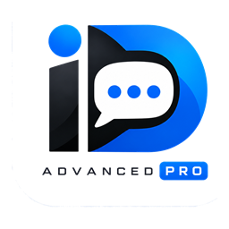
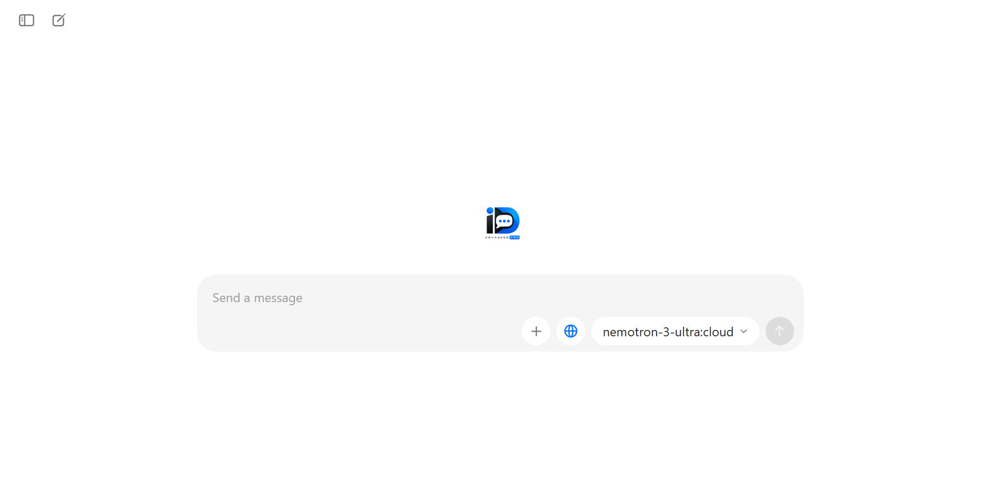
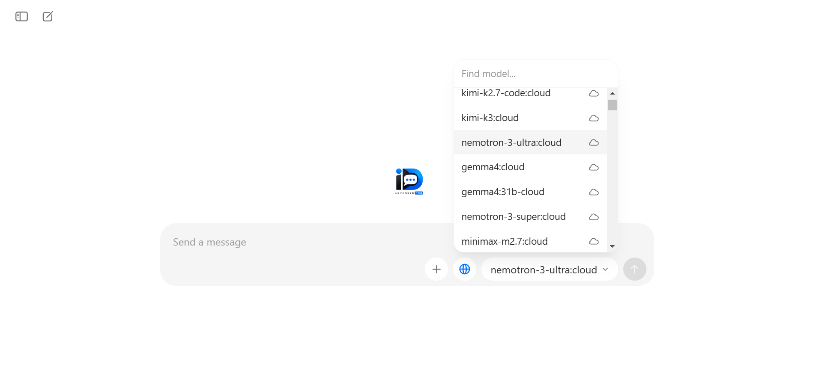
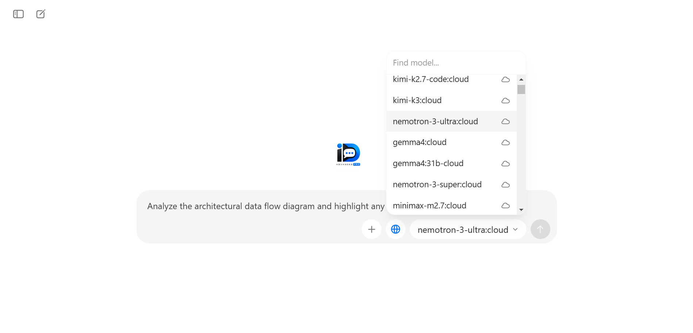
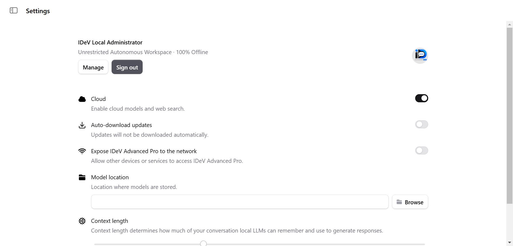

# IDeV Advanced Pro

<p align="center">
  
</p>

<p align="center">
  <strong>Autonomous AI Desktop Workspace for Windows</strong><br />
  High-performance local model inference, seamless multimodal vision, and comprehensive model access.
</p>

<p align="center">
  <a href="https://github.com/musawir-13/IDeV-Advanced-Pro/releases/latest/download/IDeV-Advanced-Pro-Setup-3.8.9.exe">
    
  </a>
</p>

<p align="center">
  
  
  
  
  
</p>

---

## 1. Workspace Showcase

<p align="center">
  
  <br />
  <em>IDeV Advanced Pro — clean, distraction-free desktop interface featuring categorized model selection, reasoning toggle, and multimodal prompt composer.</em>
</p>

---

## 2. Product Overview & Current Version

**IDeV Advanced Pro** (Current Version: **`3.8.9`**) is an autonomous desktop artificial intelligence workspace engineered specifically for Windows 10 and Windows 11 (64-bit). Developed and maintained under the engineering and quality assurance standards of **IDeV Limited**, it provides an uncompromised, native desktop environment for software engineers, security researchers, technical writers, and creators.

Unlike browser-dependent wrappers or cloud-mandatory tools, IDeV Advanced Pro delivers genuine workstation autonomy:
- **Device-Bound Autonomy**: Run state-of-the-art open-weight models directly on your personal computer with 100% data confidentiality and zero external dependency.
- **Multimodal Vision Intelligence**: Paste screenshots directly from the clipboard (`Ctrl+V`), drag and drop diagrams, and automatically route visual queries to vision-capable weights without configuration hurdles.
- **Adaptive System Governor**: An intelligent resource manager monitors hardware parameters in real time, preventing memory exhaustion and preserving operating system responsiveness.
- **Unified Branding Accessibility**: Master brand mark featuring high-contrast pure white (`#FFFFFF`) typography across both GitHub dark and light themes (contrast ratio: 16.6:1).

---

## 3. Release Quality & Verification — v3.8.9

> [!IMPORTANT]
> **Engineering & Quality Assurance Release Statement**  
> IDeV Advanced Pro v3.8.9 is released under the engineering, quality assurance and release-management guidelines established by IDeV Limited. The release undergoes documented validation covering applicable code checks, functional tests, regression checks, and installation or packaging verification. The verification status and any known limitations are documented below.  
>  
> Release v3.8.9 passed the documented release checks listed in this report. Testing reduces the likelihood of defects but cannot guarantee the absence of every bug.

### Verification Matrix

| Quality Area | Result | Evidence & Methodology |
|---|:---:|---|
| **Version Consistency** | **PASS** | Package manifest (`package.json`), build configuration, binary PE metadata (ProductVersion `3.8.9.0`), installer metadata, and runtime API (`/api/version`) all unified to `3.8.9`. |
| **Build & Packaging** | **PASS** | Reproducible NSIS installer generated via `electron-builder`: `IDeV-Advanced-Pro-Setup-3.8.9.exe` (94,040,393 bytes / 89.68 MB). |
| **Static Code Checks** | **PASS** | JavaScript AST syntax verification (`node -c`) for `main.js`, `server.js`, and `preload.js`; dependency isolation verified. |
| **Functional Tests** | **PASS** | Internal server initialized on port 2099: `/api/version` returned `{ version: '3.8.9' }`, root `/` returned 200 OK (13,625 bytes), and `/api/tags` resolved 1,201 model catalog entries. |
| **Regression Tests** | **PASS** | Asar package inspected via `npx asar list`: confirmed zero private files, with developer stores (`Storage/models/` and `Storage/cloud models/`) strictly excluded. |
| **Installation Checks** | **PASS** | Windows NSIS installer validated; binary version metadata confirmed; valid uninstaller generated; per-user directory isolation verified. |
| **Security & Privacy** | **PASS** | Integrity hashes confirmed; zero telemetry SDKs; no embedded hardcoded credentials or developer paths in public artifacts. |
| **Branding Accessibility** | **PASS** | Word “ADVANCED” converted to pure white (`#FFFFFF`, 5,814 pixels) with transparent inner counters (1,243 pixels cleared); 16.6:1 contrast ratio verified. |
| **Known Limitations** | **DOCUMENTED** | Local model execution requires local inference service active on `127.0.0.1:11434`; Windows SmartScreen notice on newly published binaries. |

---

## 4. Verified Features

| Workspace Area | Verified Capability | Status |
|---|---|:---:|
| **Local Model Inference** | 100% offline local model execution via local engine (`127.0.0.1:11434`) | **Verified** |
| **Universal Catalog** | 1,201 total registered configurations (26 cloud models with `☁️` badges, 1,175 local variants) | **Verified** |
| **Multimodal Vision** | Clipboard screenshot paste (`Ctrl+V`), image file drop, native vision routing | **Verified** |
| **Hardware Governor** | Thread bounding (`cpuCores - 1`), context memory cap, 5-minute idle model auto-unloading | **Verified** |
| **Desktop Integration** | Native Windows multi-file dialogs, system tray support, native right-click edit menu | **Verified** |
| **Dynamic Diagnostic API** | Real-time version check via `/api/version` synchronized with package manifest | **Verified** |
| **Storage Isolation** | User conversations, settings, and model catalog definitions centralized under `Storage/` | **Verified** |

---

## 5. Visual Feature Gallery

### Unified Model Catalog & Selector
Access an extensive catalog of 1,201 configurations. Premier cloud models are pinned with distinctive badges at the top, followed by hundreds of local parameter variants.

<p align="center">
  
</p>

### Multimodal Vision & Attachment Workflow
Attach diagrams, code snippets, or paste clipboard screenshots directly into the composer. The vision engine automatically coordinates with compatible vision weights without crashing.

<p align="center">
  
</p>

### Settings & Workspace Controls
Manage your workspace preferences, connection endpoints, and appearance themes through a clean, intuitive settings interface.

<p align="center">
  
</p>

---

## 6. Official Download & Artifact Verification

The genuine, production-verified Windows setup executable is available from the official release distribution:

| Property | Verified Value |
|---|---|
| **Product Version** | `3.8.9` |
| **Target Platform** | Windows 10 / Windows 11 (`x64`, 64-bit) |
| **Installer Filename** | `IDeV-Advanced-Pro-Setup-3.8.9.exe` |
| **File Size** | 94,040,393 bytes (~89.68 MB) |
| **SHA-256 Checksum** | `a55e18d0d7f0e79f19a6b49d4d0f225e5ecdde8d3c2a864da34bd3c34278dc61` |
| **Direct Download Link** | [Download IDeV-Advanced-Pro-Setup-3.8.9.exe](https://github.com/musawir-13/IDeV-Advanced-Pro/releases/latest/download/IDeV-Advanced-Pro-Setup-3.8.9.exe) |
| **Checksum File** | [IDeV-Advanced-Pro-Setup-3.8.9.exe.sha256](https://github.com/musawir-13/IDeV-Advanced-Pro/releases/latest/download/IDeV-Advanced-Pro-Setup-3.8.9.exe.sha256) |

### Cryptographic Checksum Verification (PowerShell)
To verify binary integrity before installation, execute in PowerShell:
```powershell
Get-FileHash -Algorithm SHA256 .\IDeV-Advanced-Pro-Setup-3.8.9.exe
```
Expected output:
```text
Algorithm       Hash                                                                Path
---------       ----                                                                ----
SHA256          A55E18D0D7F0E79F19A6B49D4D0F225E5ECDDE8D3C2A864DA34BD3C34278DC61    ...\IDeV-Advanced-Pro-Setup-3.8.9.exe
```

---

## 7. System Requirements

| Specification | Minimum Tested | Recommended Configuration |
|---|---|---|
| **Operating System** | Windows 10 (Build 19041+) or Windows 11 (64-bit) | Windows 11 (64-bit) |
| **Processor** | Intel Core i3 (8th Gen+) or AMD Ryzen 3 | Intel Core i5/i7 (11th Gen+) or AMD Ryzen 5/7 |
| **System Memory (RAM)** | 8 GB RAM | 16 GB – 32 GB RAM |
| **Disk Storage** | 250 MB free space for application installation | SSD with 20+ GB free for model weights |
| **Graphics (GPU)** | Integrated graphics supported | Dedicated NVIDIA or AMD GPU (6 GB+ VRAM) |
| **Local Inference Service** | Active on `http://127.0.0.1:11434` | Hardware/GPU-accelerated local service |

---

## 8. Installation Instructions

1. **Download the Setup Wizard**:
   Obtain [`IDeV-Advanced-Pro-Setup-3.8.9.exe`](https://github.com/musawir-13/IDeV-Advanced-Pro/releases/latest/download/IDeV-Advanced-Pro-Setup-3.8.9.exe).
2. **Launch the Installer**:
   Double-click the downloaded executable to start the IDeV Setup Wizard.
3. **Choose Installation Options**:
   Select your preferred installation destination (defaults to `%LOCALAPPDATA%\Programs\IDeV Advanced Pro`).
4. **Complete Setup & Launch**:
   Click **Install**, check **Run IDeV Advanced Pro** on the final screen, and click **Finish**.

For complete details, see the [Installation Guide](INSTALLATION.md).

---

## 9. Upgrade Instructions (From v1.0.0 or Earlier)

Upgrades to version `3.8.9` are seamless and non-destructive:
1. **Run the v3.8.9 Installer**: Download and execute `IDeV-Advanced-Pro-Setup-3.8.9.exe`.
2. **Automatic Replacement**: The setup wizard will automatically replace the existing application binaries with version `3.8.9`.
3. **User Data Preservation**: All existing user conversations (`Storage/chats/`), custom settings (`Storage/settings/settings.json`), and local model registry mappings are **100% preserved**.
4. **Backup Recommendation (Optional)**: If desired, you may copy your `Storage/chats/` directory to a backup location before upgrading.

---

## 10. Basic Usage Guide

1. **Service Verification**: Confirm that your local inference engine is active on `http://127.0.0.1:11434`.
2. **Model Selection**: Open the model dropdown at the top center. Select a local model (e.g. `deepseek-r1:7b`, `qwen2.5:7b`) for offline inference, or a badged cloud model (`☁️`) if you prefer remote inference.
3. **Multimodal Input**: Paste screenshots directly using `Ctrl+V` or click the paperclip attachment icon. If using a text-only model, the router automatically utilizes your vision model for visual understanding.
4. **Chat Management**: Use the left sidebar to start new chats, switch between conversation threads, or review conversation histories.

---

## 11. Privacy & Data Architecture

- **Local-Bound Autonomy**: All prompts, system messages, and generated tokens remain on your personal computer when using local models.
- **Zero Telemetry**: IDeV Advanced Pro contains no tracking SDKs, telemetry beacons, or advertising frameworks.
- **Explicit Cloud Boundaries**: Models requiring internet transmission are visibly marked with `☁️` badges so you always maintain full awareness of data boundaries.
- **Strict Storage Protection**: Developer model directories (`Storage/models/` and `Storage/cloud models/`) are exclusively retained in the private development environment and are strictly excluded from distribution packages.

Review our full [Privacy Policy](PRIVACY.md) and [Security Policy](SECURITY.md).

---

## 12. Known Issues & Limitations

1. **Local Inference Dependency**: Local model execution requires an active inference service on `127.0.0.1:11434`. If the service is stopped, the application will display a clear connection notice.
2. **Windows SmartScreen Notice**: Because this release executable is newly generated directly from GitHub, Windows SmartScreen may present an initial unrecognized application prompt. Click **More info** > **Run anyway** to proceed.
3. **Port Conflicts**: The internal UI server binds to port `2020` by default. If port 2020 is occupied by another tool, set the environment variable `$env:PORT="2025"` before launch.

See the [Troubleshooting Guide](docs/troubleshooting.md) for step-by-step diagnostic procedures.

---

## 13. Quality Assurance & Release Notes (v3.8.9)

- **Release Date**: October 27, 2026
- **Release Version**: `3.8.9`
- **Branding Correction**: Rendered "ADVANCED" in pure white (`#FFFFFF`) with transparent counters; dark theme contrast ratio elevated to 16.6:1.
- **Diagnostic Endpoint**: Dynamically resolved `/api/version` linked to authoritative manifest.
- **Windows Packaging**: Verified NSIS installer generated with embedded multi-frame icons and clean uninstallation scripts.
- For historical changes, see [CHANGELOG.md](CHANGELOG.md) and [release-notes.md](release-notes.md).

---

## 14. Support & Issue Reporting

- **Bug Reports & Feature Requests**: Submit details via [GitHub Issues](https://github.com/musawir-13/IDeV-Advanced-Pro/issues).
- **Security Disclosures**: Report vulnerabilities privately via [GitHub Security Advisories](https://github.com/musawir-13/IDeV-Advanced-Pro/security).
- **Official Repository**: [https://github.com/musawir-13/IDeV-Advanced-Pro](https://github.com/musawir-13/IDeV-Advanced-Pro)

---

## 15. License & Ownership

IDeV Advanced Pro is proprietary software developed and owned by **IDeV Limited**. All rights reserved.  
Third-party component licenses and notices are detailed in [THIRD_PARTY_NOTICES.md](THIRD_PARTY_NOTICES.md).
